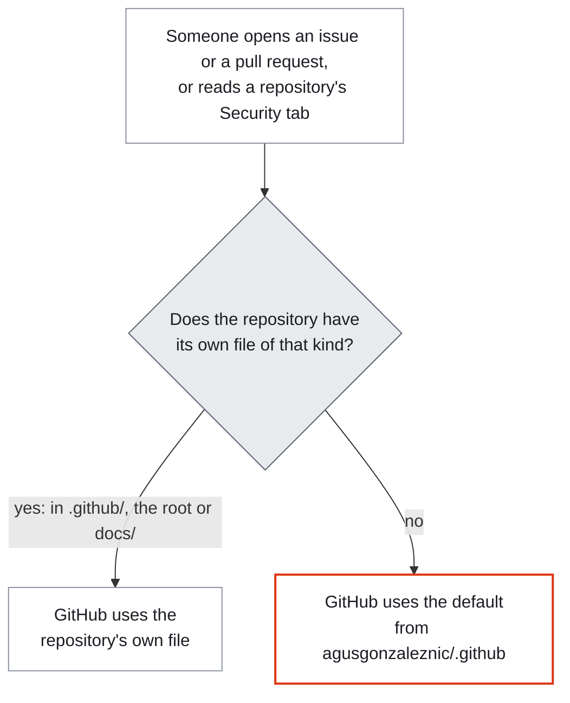
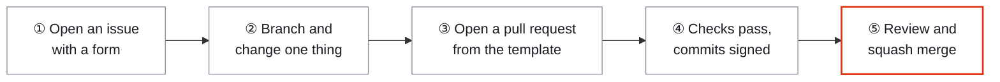

# 🤝 Community health files

### One set of house rules for every repository I keep.

**The default community health files for [github.com/agusgonzaleznic](https://github.com/agusgonzaleznic).**
Wherever a repository in this account has no file of its own for one of these jobs, GitHub uses
the one here: how to contribute, how we treat each other, how to report a vulnerability, where to
get help, the issue forms and the pull request template.
One place to change them. Every repository follows. Nothing to copy, nothing to drift.

 

 

 

**[What this is](#-what-this-is) · [How GitHub picks a file](#-how-github-picks-a-file) · [What's inside](#-whats-inside) · [Contributing](#-contributing-in-five-steps) · [Security](#-security) · [Repositories](#-repositories-it-covers) · [Support](#-support-this-work)**

---

## 🧭 What this is

Before anyone can help with a project, they need the same few things every time: how to propose a
change, what behaviour is expected, where to send a vulnerability without publishing it, where to
ask a question, and forms that ask for what a maintainer actually needs. Copied into every
repository, those files multiply and drift apart.

GitHub solves this with a public repository named **`.github`**. A file here becomes the
**default** for every repository the account owns, public or private, that has no file of that kind
of its own. GitHub shows the default exactly where the repository's own file would appear: in the
issue chooser, on a new pull request, in the Security tab and in the sidebar. The files never enter
the other repositories' history, clones or packages.

> [!NOTE]
> A default never overrides a repository's own file. No public repository here keeps one of its
> own, so every repository below uses all six defaults. What only one repository needs, such as
> drive-berlin's rules for sources, lives in that repository's README or `docs/` under another
> name.

---

## 🔍 How GitHub picks a file

| Rule | What it means in practice |
|---|---|
| **Lookup order** | `.github/` first, then the root, then `docs/`: in the repository, and then here |
| **Issue forms are all or nothing** | A repository with anything in its own `.github/ISSUE_TEMPLATE/`, even a lone `config.yml`, uses none of the forms here |
| **Any visibility** | Defaults apply to public and private repositories alike. This repository has to stay public for any of it to work |
| **No default licence** | GitHub can't default a licence, because it has to travel inside each repository's clones and packages. Each repository carries its own `LICENSE` |
| **Labels must exist** | A form only applies its label where that label exists. `bug`, `enhancement`, `question` and `documentation` exist in every public repository here |
| **The name decides** | A repository's own `SECURITY.md`, `CONTRIBUTING.md` or `CODE_OF_CONDUCT.md` in any of the three places replaces the default, so a document that only adds to a default needs another name, such as `docs/development.md` |

Source: GitHub's guide to
[creating a default community health file](https://docs.github.com/en/communities/setting-up-your-project-for-healthy-contributions/creating-a-default-community-health-file).

---

## 📦 What's inside

| File | What it does | Where people see it |
|---|---|---|
| [`CONTRIBUTING.md`](CONTRIBUTING.md) | How to propose a change: a small fix goes straight to a pull request, anything bigger starts with an issue. One change per pull request, signed commits, squash merges | A link when someone opens an issue or a pull request, and **Contributing** in the sidebar |
| [`CODE_OF_CONDUCT.md`](CODE_OF_CONDUCT.md) | The [Contributor Covenant 2.1](https://www.contributor-covenant.org/version/2/1/code_of_conduct/), with reports going to the contact details on my profile, or to GitHub when a report concerns me | **Code of conduct** in the sidebar and the community profile |
| [`SECURITY.md`](SECURITY.md) | Report a vulnerability privately through the Security tab, never in a public issue, with best-effort response targets | **Security policy** in the Security tab, and a link in the issue chooser |
| [`SUPPORT.md`](SUPPORT.md) | Where to ask a question or report a bug, and a plain note that there is no guaranteed response time | **Support** under *Helpful resources* when someone opens an issue |
| [`.github/ISSUE_TEMPLATE/`](.github/ISSUE_TEMPLATE/) | Four forms (bug report, feature request, question, and incorrect information, which needs a source) and a `config.yml` that turns blank issues off | The **New issue** chooser |
| [`.github/pull_request_template.md`](.github/pull_request_template.md) | Two sections, *What changed* and *Verification*, and a three-item checklist | The body of every new pull request |
| [`.github/CODEOWNERS`](.github/CODEOWNERS) | Requests my review on changes to this repository. CODEOWNERS is never a default, so it covers this repository only | This repository's pull requests |

---

## 🤝 Contributing in five steps

- **A small fix can skip the issue.** A typo or an obvious bug can go straight to a pull request.
  For anything bigger, an issue first saves you from building something that won't be merged.
- **Sign your commits.** Every default branch here accepts only commits with a
  [verified signature](https://docs.github.com/en/authentication/managing-commit-signature-verification/about-commit-signature-verification),
  and the history stays linear, so pull requests land as a squash merge.
- **Run the project's own checks first.** Each README says how to build and test that project.
  Where a repository runs checks on pull requests, they have to pass before the merge.
- **One change per pull request**, described in the template's two sections.

The full guide is [`CONTRIBUTING.md`](CONTRIBUTING.md).

---

## 🔒 Security

**Never report a vulnerability in a public issue.** Private vulnerability reporting is switched on
in every public repository here, so a report reaches me directly and stays private while it's fixed:

1. Open the **Security** tab of the affected repository.
2. Choose **Report a vulnerability**.
3. Describe the problem, how to reproduce it, and what an attacker could do with it.

I aim to acknowledge a report within 7 days and assess it within 30: best-effort targets, not a
service level agreement. Fixes go into the default branch and, where a repository publishes
releases, into a new release. Older commits and releases aren't patched. The full policy is
[`SECURITY.md`](SECURITY.md).

---

## 📚 Repositories it covers

Every public repository in the account except this one, and what each one takes from here.
✅ uses the default

| Repository | What it is | Contributing | Conduct | Security | Support | Issue forms | PR template |
|---|---|:--:|:--:|:--:|:--:|:--:|:--:|
| [plex-renamer](https://github.com/agusgonzaleznic/plex-renamer) | Renames a media library to the naming standard Plex publishes, with a journal that can undo any run | ✅ | ✅ | ✅ | ✅ | ✅ | ✅ |
| [github-reusable-workflows](https://github.com/agusgonzaleznic/github-reusable-workflows) | The shared GitHub Actions workflows the other repositories call, pinned to full commit SHAs | ✅ | ✅ | ✅ | ✅ | ✅ | ✅ |
| [drive-berlin](https://github.com/agusgonzaleznic/drive-berlin) | *Führerschein Hero*: converting a non-EU driving licence in Berlin, with a full theory course in English | ✅ | ✅ | ✅ | ✅ | ✅ | ✅ |
| [cvcite](https://github.com/agusgonzaleznic/cvcite) | Builds a truthful, ATS-safe CV from one YAML file | ✅ | ✅ | ✅ | ✅ | ✅ | ✅ |
| [terraform-provider-immobilienscout24](https://github.com/agusgonzaleznic/terraform-provider-immobilienscout24) | A Terraform provider for ImmobilienScout24: German property listings as code | ✅ | ✅ | ✅ | ✅ | ✅ | ✅ |
| [terraform-aws-static-website](https://github.com/agusgonzaleznic/terraform-aws-static-website) | A Terraform module for static websites on AWS | ✅ | ✅ | ✅ | ✅ | ✅ | ✅ |
| [terraform-aws-s3-bucket](https://github.com/agusgonzaleznic/terraform-aws-s3-bucket) | A Terraform module for S3 buckets | ✅ | ✅ | ✅ | ✅ | ✅ | ✅ |
| [mta-sts](https://github.com/agusgonzaleznic/mta-sts) | MTA-STS and TLS-RPT policy hosting that enforces encrypted mail delivery | ✅ | ✅ | ✅ | ✅ | ✅ | ✅ |
| [agusgonzaleznic.github.io](https://github.com/agusgonzaleznic/agusgonzaleznic.github.io) | My site and blog: React and Vite with Storyblok, in six languages, deployed to AWS with Terraform | ✅ | ✅ | ✅ | ✅ | ✅ | ✅ |
| [agusgonzaleznic](https://github.com/agusgonzaleznic/agusgonzaleznic) | My GitHub profile | ✅ | ✅ | ✅ | ✅ | ✅ | ✅ |

Read from each repository's default branch on 14 November 2026. A repository that adds a file
of its own stops using the default for that kind of file, and only for that kind.

---

## 🔧 Changing a default

A change here reaches every repository that uses the file as soon as it merges, with nothing to
copy anywhere. It goes through a pull request like any other change, and CODEOWNERS asks for my
review.

To give one repository something different, add the file to that repository instead. The default
stops applying there for that kind of file.

<b>What isn't here, and why</b>

| File | Why it isn't here |
|---|---|
| `LICENSE` | GitHub doesn't support a default licence. Each repository carries its own |
| `FUNDING.yml` | Every repository that shows a Sponsor button has its own |
| Discussion category forms | Discussions are off in every repository |
| `VULNERABILITY_REPORT.yml` | GitHub's standard private report form is enough for now |

---

## 💛 Support this work

The projects here are free, and they stay free. Three things help, in ascending order of effort:

- **Star the repositories you use.** It's the only signal that tells the next person they exist.
- **Open an issue when something is wrong**, with the form that fits. A precise report with the
  steps to reproduce it is the most useful contribution anyone can make.
- **Drop a coffee on Ko-fi, or sponsor on GitHub.** Ko-fi is a one-off, and GitHub Sponsors can
  be monthly or one-time, with a custom amount.

 

 

 

Built in Berlin by <b>Agustin Gonzalez Nicolini</b>. I work on engineering leadership and write
about it at <a href="https://agusgonzaleznic.com">agusgonzaleznic.com</a>.

---

## 📄 Licence and attribution

GitHub can't make a licence a default, so each repository carries its own `LICENSE`.

The code of conduct is the [Contributor Covenant](https://www.contributor-covenant.org), version
2.1, by its authors under [CC BY 4.0](https://creativecommons.org/licenses/by/4.0/), and credited
at the end of [`CODE_OF_CONDUCT.md`](CODE_OF_CONDUCT.md).

 

